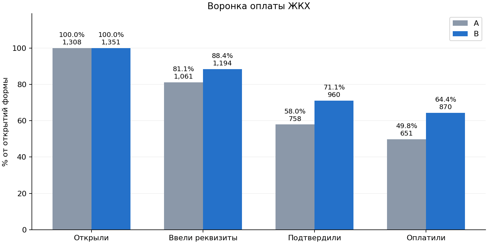
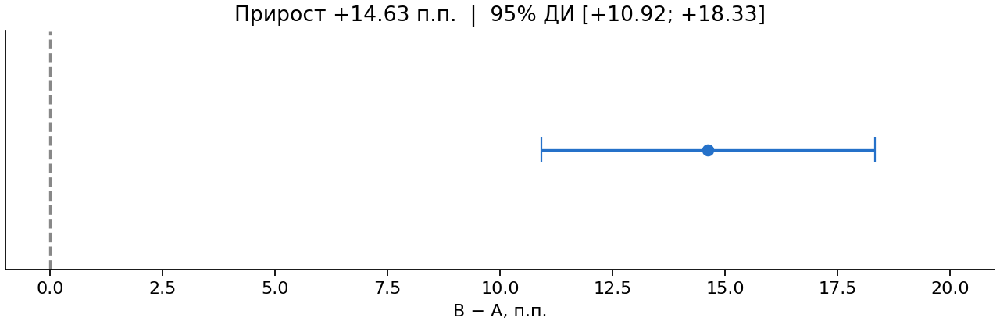
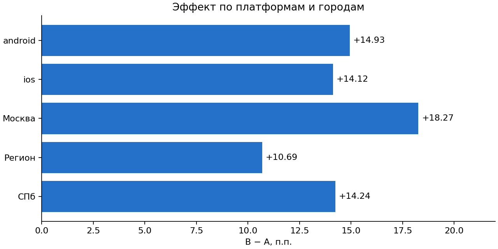

# A/B-тест формы оплаты ЖКХ

В эксперименте за 1–30 апреля 2024 года конверсия из открытия формы в успешную оплату составила 49,77% в A и 64,40% в B. Разница **+14,63 п.п.**, 95% ДИ **[+10,92; +18,33] п.п.**, двустороннее **p ≈ 1,03 × 10⁻¹⁴**. В выводе предполагается, что B видела форму с автозаполнением.

**Материалы:** [слайд «Выборка и очистка»](https://www.figma.com/slides/IxeYaNwEhb02IjiJkHspqq?node-id=3-64) · [вся презентация](https://www.figma.com/slides/IxeYaNwEhb02IjiJkHspqq)

| Метрика | A | B |
|---|---:|---:|
| Успешные оплаты / открытия формы | 651 / 1 308 | 870 / 1 351 |
| Конверсия попыток | 49,77% | 64,40% |
| Клиенты с ≥1 успешной оплатой / клиенты, открывшие форму | 493 / 751 | 603 / 750 |
| Доля клиентов с ≥1 успешной оплатой | 65,65% | 80,40% |







## Как воспроизвести

Требуется Python 3.11+ и исходный Excel из задания с листами «Пользователи» и «Платежи». В репозитории лежат агрегаты и графики. Построчная выгрузка не публикуется.

```bash
python -m venv .venv
source .venv/bin/activate
python -m pip install -r requirements.txt
python analysis.py "/путь/к/данным.xlsx" --out results
```

Скрипт проверяет идентификаторы и последовательность шагов, присоединяет группу по идентификатору клиента и исключает попытки без установленной группы или с конфликтом группы. Пропуски после открытия сохраняет как отвал. Проверку 50/50 проводит по назначенным клиентам.

Основная метрика взвешена по попыткам. Для доверительного интервала и z-теста используется дельта-метод с кластеризацией по клиентам. Независимая проверка интервала — 30 000 bootstrap-выборок клиентов внутри групп. Срезы по платформам и городам описательные.

В `results/` сохраняются три графика, `summary.json` с оценками и проверками, а также `segments.csv` с размерами и конверсиями сегментов.
